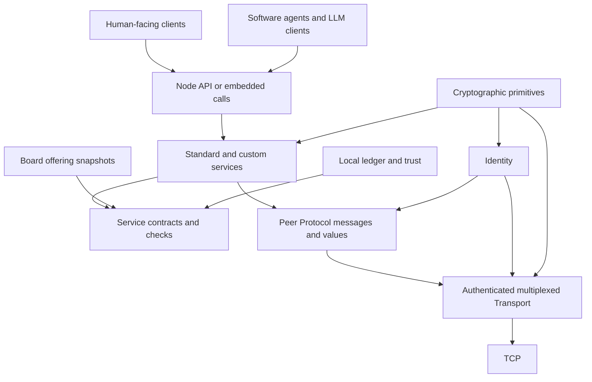
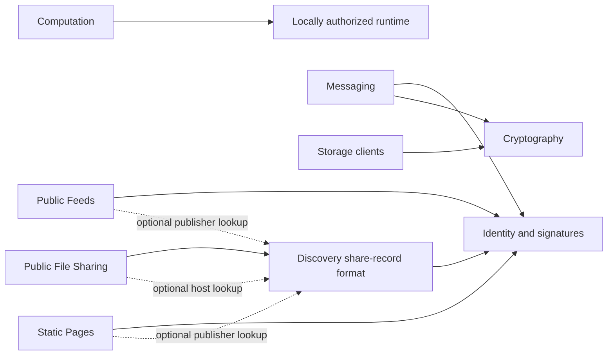
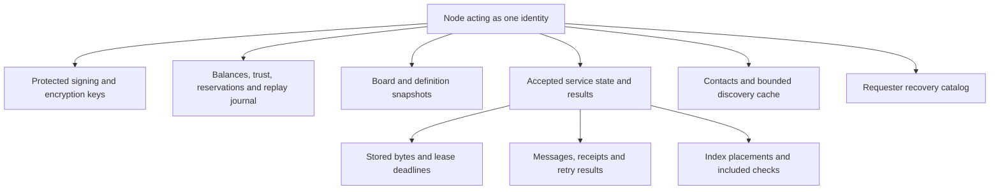

# Architecture

CR2SE makes useful cooperation possible without a global account provider,
currency, directory, or storage operator. Each community can run its own nodes
and choose its own trust and resource policies. Wider reach requires separate
paid relationships; there is no implicit free global broadcast.

## Layers

These are responsibilities, not required packages or deployment processes.
An embedded library and a standalone node can implement the same protocol.

Arrows here show information flowing into or being used by another layer.
Service policy does not change Transport frames. Content encryption is selected
above Transport; mandatory frame integrity does not hide the payload.

## Dependencies between service families

All service families use Services, Board, Ledger, and Peer Protocol. The graph
below shows additional reuse. An arrow means “uses the format or capability of”.

Storage and Messaging remain separate: a storage lease is an opaque-byte
retention agreement, while a message placement has sender/recipient roles,
recovery receipts, and state transitions. Public Files identify immutable trees
by hash. Pages identify mutable publisher paths. Public Feeds identify signed
author messages. Sharing implementation helpers is useful; merging these
contracts would hide meaningful differences.

Discovery's public-share format does not require the indexer to run a file
server. File Sharing can encode that format without invoking Discovery. An
encrypted object can be stored without the storage provider decrypting it.

## One participant's state

Databases, threads, event loops, file layouts, and replication mechanisms are
implementation choices. The visible invariants are not: preserve balances,
accepted obligations, immutable data, replay guards, and exact outputs across
ordinary restarts. Multiple nodes sharing keys must coordinate this state.

## Community and wider reach

A new node needs at least one endpoint from configuration, a contact QR, or a
previous relationship. It can read bounded metadata, fulfill wanted work, redeem
a claim, or receive an explicit trust/credit grant. No identity acquires trust
simply by creating a key or being described as human.

Discovery is iterative and requester-controlled. Each query has its own cost;
each referred provider independently evaluates trust and accepted credits. Stop
when a time, peer, byte, or credit budget is exhausted. Paid enumeration makes
scraping consume resources; it does not make copying public data impossible.

An outbound TCP connection also accepts inbound service requests on other
streams. This helps domestic nodes serve known reachable peers. Version 1 does
not solve every NAT combination or define a relay service. Deploy a reachable
community endpoint for the first PoC and test an outbound-only member.

## Recovery and reliability

Keep independent replicas at different identities, monitor them, and renew well
before expiration. Preserve keys and the recovery catalog independently of the
original hardware. The catalog links application data to providers, lease IDs,
content hashes, encryption formats, and expiry times.

Neither a successful byte sample nor a chosen replica count guarantees uptime.
Providers can disappear, lose data, or change future prices. Test recovery with
one provider offline and replace replicas before the remaining lease expires.

## Clients and autonomous agents

Both use the same IDs, typed contracts, quote acceptance, spending limits, and
checks. An agent must have explicit local authority for issuers, budgets, and
resource use. A peer's service description is data to inspect; it is not an
instruction to override that authority. Separate model reasoning from the
deterministic parser, signature verifier, ledger, and execution permissions.
