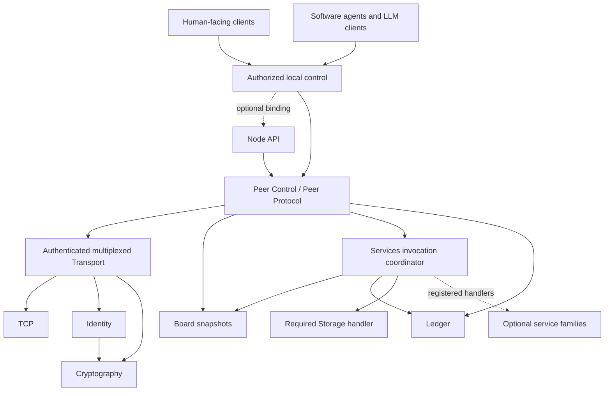
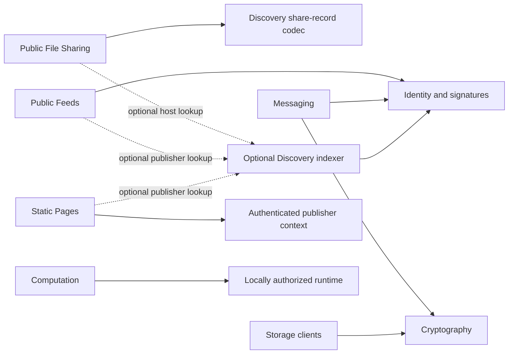
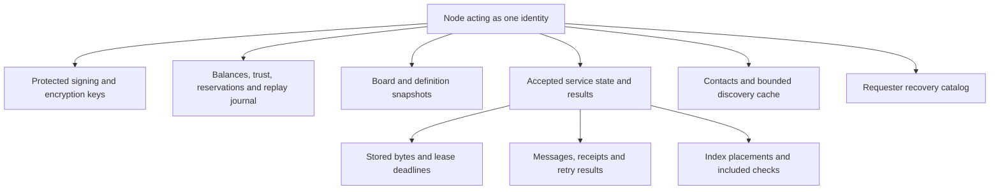

# Architecture

CR2SE makes useful cooperation possible without a global account provider,
currency, directory, or storage operator. Each community can run its own nodes
and choose its own trust and resource policies. Wider reach requires separate
paid relationships; there is no implicit free global broadcast.

## Layers

These are independently implementable responsibilities, not required packages
or deployment processes. Each module exposes explicit inputs and outputs.
[Module contracts](./ModuleContracts.md) define authority, state ownership,
streaming, dependency substitution and recovery across those boundaries.

The required core is Identity, Cryptography, Transport, Peer Control (the
Peer Protocol module), Ledger, Board, Services and Storage. Services is necessary
to invoke and settle Storage. Node API and the other six service families are
optional. Required describes a useful node profile, not what every individual
module must load. A module can be built with substitutes for its dependencies.

Arrows show a caller using a capability through its contract. Responses return
over that same boundary; the drawing does not dictate thread or process layout.
Service policy does not change Transport frames. Content encryption is selected
above Transport; mandatory frame integrity does not hide the payload.

## Composition and independent state

A monolith may implement these boundaries as calls and transactions. Separate
logical units may use adapters; separate processes may use authenticated IPC/RPC
and independent stores. Preserve the same input validation, exact values,
caller authority, stream completion and failure semantics in all three cases.
No module may rely on reaching into another module's private tables or objects.

Board owns an atomic publication of offerings and definitions. Services owns
accepted invocation context and coordination; Ledger owns credit/trust state;
each family owns its resources and replay guards. Board consumes the Services
schema format without requiring its running coordinator. Services discovers
handlers through local composition, not through importing their internals.
This avoids a startup cycle between publication, schemas and handler dispatch.

Local persistence is a platform capability. Ledger does not buy a Storage lease
to save its balances, and Messaging does not need the Storage service to retain
messages. An implementation may share a database engine while retaining the
same ownership boundaries. For independent databases, use the
[durable coordination contract](./ModuleContracts.md#durable-effects-across-process-boundaries)
to recover local service and accounting effects without requiring a shared
transaction manager or pretending an IPC timeout proves rollback.

Startup validates the configured dependency ports and registers usable
capabilities. Missing optional handlers produce no provided offering and fail
unsupported invocations before acceptance. Existing leases, receipts and replay
records remain obligations even when new offerings are disabled. Configured
contacts and local administration make the core usable without Discovery or
Node API. See the [minimum demonstration](./PoC.md#minimum-useful-profile).

## Dependencies between service families

All network service invocations use Services, Board, Ledger and Peer Control.
A family handler consumes Services context; adapters supply those other core
capabilities without giving the handler direct database or socket access. The
graph below shows additional format/capability reuse, not mandatory process
deployment. Discovery lookup is optional for clients with known contacts.

Storage and Messaging remain separate: a storage lease is an opaque-byte
retention agreement, while a message placement has sender/recipient roles,
recovery receipts, and state transitions. Public Files identify immutable trees
by hash. Pages identify mutable publisher paths. Public Feeds identify signed
author messages. Sharing implementation helpers is useful; merging these
contracts would hide meaningful differences.

Discovery's public-share format does not require the indexer to run a file
server. File Sharing can encode that format without invoking Discovery. An
encrypted object can be stored without the storage provider decrypting it.

## One participant's state

This is a logical view of one participant, not a required shared database.
Databases, threads, event loops, file layouts, and replication mechanisms are
implementation choices. The visible invariants are not: preserve balances,
accepted obligations, immutable data, replay guards, and exact outputs across
ordinary restarts. Multiple nodes sharing keys must coordinate this state.

## Community and wider reach

A new node needs at least one endpoint from configuration, a contact QR, or a
previous relationship. It can read bounded metadata, fulfill wanted work, redeem
a claim, or receive an explicit trust/credit grant. No identity acquires trust
simply by creating a key or being described as human.

Discovery is iterative and requester-controlled. Each query has its own cost;
each referred provider independently evaluates trust and accepted credits. Stop
when a time, peer, byte, or credit budget is exhausted. Paid enumeration makes
scraping consume resources; it does not make copying public data impossible.

An outbound TCP connection also accepts inbound service requests on other
streams. This helps domestic nodes serve known reachable peers. Version 1 does
not solve every NAT combination or define a relay service. Deploy a reachable
community endpoint for the first PoC and test an outbound-only member.

## Recovery and reliability

Keep independent replicas at different identities, monitor them, and renew well
before expiration. Preserve keys and the recovery catalog independently of the
original hardware. The catalog links application data to providers, lease IDs,
content hashes, encryption formats, and expiry times.

Neither a successful byte sample nor a chosen replica count guarantees uptime.
Providers can disappear, lose data, or change future prices. Test recovery with
one provider offline and replace replicas before the remaining lease expires.

## Clients and autonomous agents

Both use the same IDs, typed contracts, quote acceptance, spending limits, and
checks. An agent must have explicit local authority for issuers, budgets, and
resource use. A peer's service description is data to inspect; it is not an
instruction to override that authority. Separate model reasoning from the
deterministic parser, signature verifier, ledger, and execution permissions.
