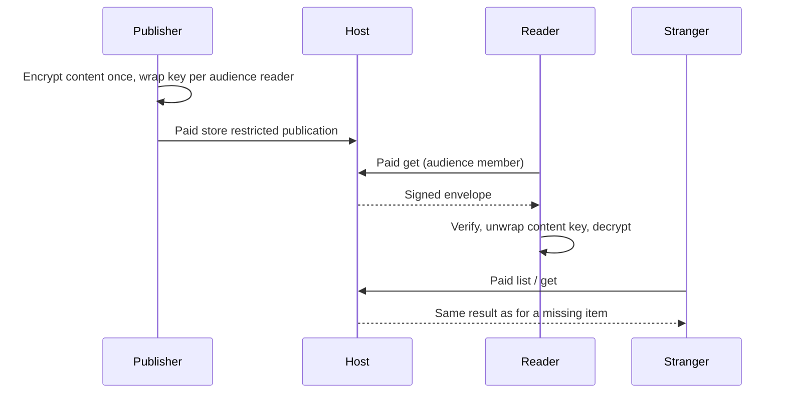
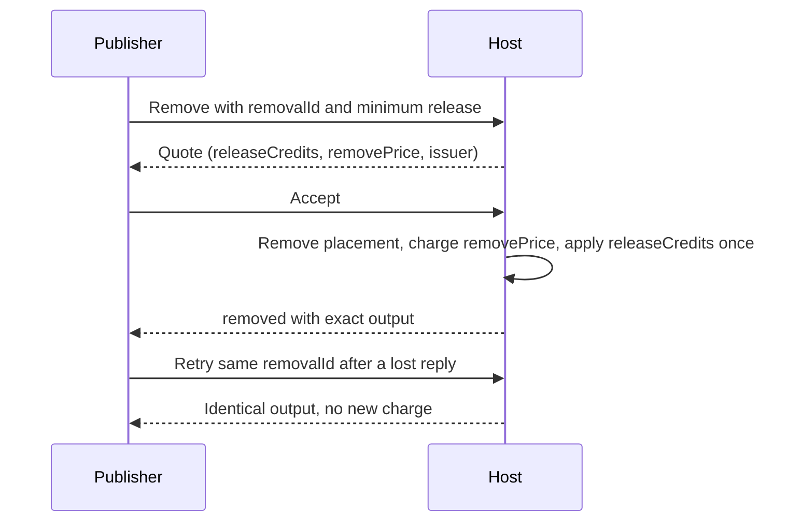

# Hosted Publications diagrams

[Specification](../README.md) · [Architecture and dependencies](../../../Architecture.md)

```mermaid
sequenceDiagram
    participant Publisher as Publisher (phone, outbound only)
    participant HostA as Host A
    participant HostB as Host B
    participant Reader
    Publisher->>Publisher: Sign resources, then the page manifest
    Publisher->>HostA: Paid store (resources, then page)
    Publisher->>HostB: Paid store (same signed bytes)
    HostA-->>Publisher: Durable placement
    HostB-->>Publisher: Durable placement
    Note over Publisher: Publisher goes offline
    Reader->>HostA: Paid list (page, newest first)
    HostA-->>Reader: Entries with sequence and hash
    Reader->>HostA: Paid get (manifest)
    Reader->>HostB: Paid get (resource by publication ID)
    Reader->>Reader: Verify signatures, hashes, manifest; choose highest sequence
```




