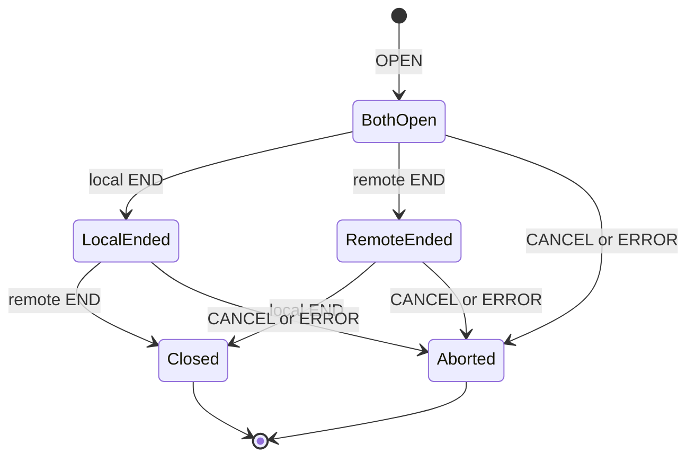
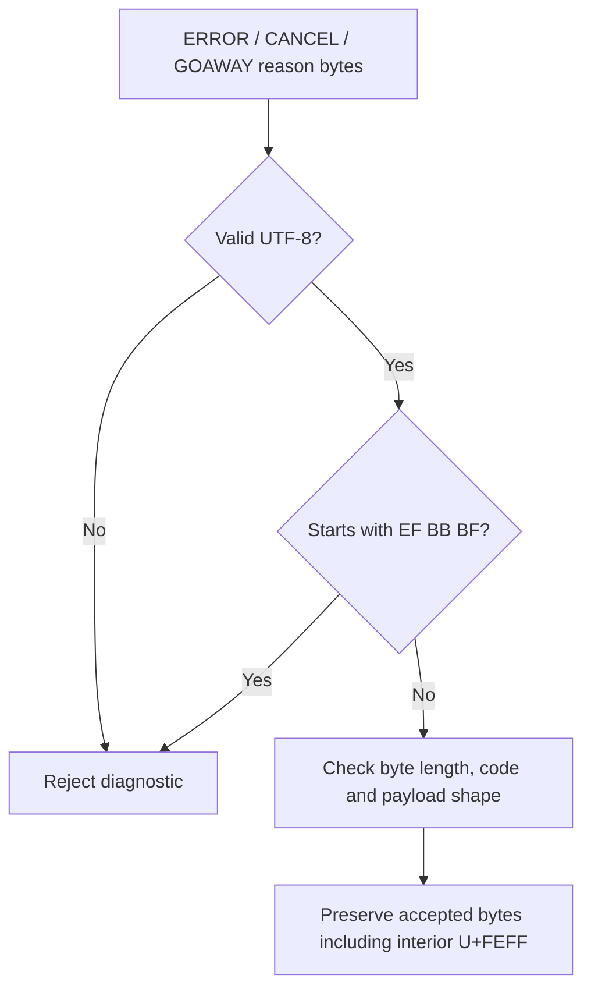

# Transport diagrams

[Specification](../README.md) · [Architecture and dependencies](../../../Architecture.md)

```mermaid
sequenceDiagram
    participant I as TCP initiator
    participant A as TCP acceptor
    I->>A: Open TCP connection
    I->>A: HELLO with public key, ephemeral key, nonce
    A->>I: HELLO with public key, ephemeral key, nonce
    I->>A: AUTH signature over role and both HELLOs
    A->>I: AUTH signature over role and both HELLOs
    Note over I,A: Each sends AUTH before waiting for the peer AUTH; no session keys yet
    Note over I,A: Verify peer AUTH first; failure closes without response or derivation
    Note over I,A: Only then calculate X25519, reject zero, and run HKDF
    Note over I,A: Install both directions with counters zero; erase ephemeral secrets
    I->>A: Tagged OPEN stream 1 for cr2se.peer version 1
    I->>A: Tagged DATA records
    A->>I: Tagged DATA records
    I->>A: Tagged END for stream 1
    A->>I: Tagged END for stream 1
    Note over I,A: TCP remains open for other streams, content is visible
```





The same leading-BOM restriction applies when encoding local diagnostic text.
Incoming malformed diagnostics cause a connection error; outgoing invalid
reasons are rejected before encoding.
